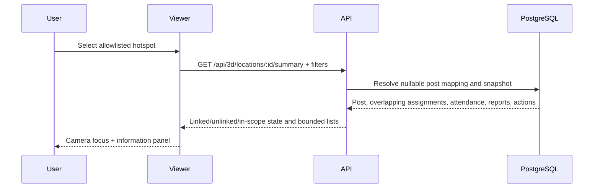

# 3D Security Command Centre architecture

## Modelling and public delivery

`artifacts/suk/Bangunan_SUK_Exterior.blend` is the Blender source; `.blend1` is its local backup, both published to GitHub main in commit `2123350` at the user's request. `artifacts/suk/Bangunan_SUK_Exterior.glb` exports the exterior; the served copy is `public/models/Bangunan_SUK.glb`. Phase 2 authorization explicitly permits public distribution of the demo exterior. This approval does not authorize publishing operational data or other building files.

The exterior is an approximation from reference photographs, not a surveyed architectural reconstruction. It contains 192 meshes, 57,310 triangles and 13 materials, totaling 2,537,652 bytes. Material and geometry loading are covered by model checks and actual browser screenshots. Do not infer accurate dimensions, room layouts or security-sensitive internal zones.

## Scene, selection and data flow

`src/components/building/BuildingViewer.jsx` coordinates the scene, selection, filters and information panel. Companion components handle model loading, camera control, errors and responsive panels. Hotspot configuration identifies seven anchors: main entrance, central block, left/right wings, front plaza and left/right towers. Camera presets include an overview and selected-location focus; orbit, zoom, pan and animated focus operate through Three.js/Drei controls. Reduced-motion preferences shorten or suppress motion. Zone selection highlights the configured exterior region rather than hiding arbitrary structural geometry.

Only administrators may change mappings; chief guards can read. Mapping changes are audited. Unlinked locations show no invented records. Filtered-out locations are identified separately from unlinked anchors. Schedules describe planned duty; recorded attendance describes a database event, never verified physical presence.

Marker modes use stored incident and operational summaries; there is no predictive risk heatmap or calculated building safety percentage. Filters cover dates (MYT), zone, mapping, post, risk, category, report status and action status. Incident history is paginated (max 50); summary lists are limited to 200 assignments, 10 reports and 20 actions. Reports without analysis remain Unknown. Multiple analyses use the latest result, including category and severity from that same row.

The operational date includes prior-day overnight assignments overlapping the selected KL day. This read behavior is broader than the attendance mutation endpoint, which currently allows only assignments dated current_date. The API polls stored records; no continuous physical synchronization, GPS or sensor network exists. Describe it as an interactive 3D operational visualization, not a fully synchronized digital twin.

## Verification and performance boundaries

Phase 5 covered 10 model/logic tests, 18 mocked browser regressions and five genuine API/browser workflows. Phase 6 adds synthetic API lifecycle checks and 17 actual screenshots. Edge headless SwiftShader results are reported in [final testing](../../psm/FINAL_TESTING_REPORT.md); emulated mobile is not a physical phone test. WebGL failure has a fallback message; minimum hardware/browser support remains to be established on examiner equipment. No architectural accuracy or usability benefit has been scientifically validated.
