# Database design

Generated from the actual `backend/database/schema.sql` plus additive `003_lokasi_3d.sql`: 20 application tables. The demo manifest tables are isolated tooling, not production entities. Diagram source: [database-erd.mmd](diagrams/database-erd.mmd). Nullable foreign keys use optional parent cardinality; each child may have at most one referenced parent and each parent may have zero or many children. SQL unique indexes further constrain particular relationships.

```mermaid
erDiagram
  tbl_peranan {
    serial id_peranan PK
    varchar nama_peranan
    text keterangan_peranan
    int tahap_capaian
    timestamp tarikh_dicipta
  }
  tbl_pengguna {
    serial id_pengguna PK
    int id_peranan FK
    varchar nama_penuh
    varchar no_kad_pengenalan
    varchar no_telefon
    varchar emel
    varchar nama_pengguna
    text kata_laluan
    varchar status_akaun
    timestamp tarikh_dicipta
    timestamp tarikh_kemaskini
  }
  tbl_peranan ||--o{ tbl_pengguna : "id_peranan"
  tbl_pos_kawalan {
    serial id_pos PK
    varchar nama_pos
    varchar nama_bangunan
    text lokasi
    varchar waktu_operasi
    varchar status_pos
    timestamp tarikh_dicipta
  }
  tbl_kategori_insiden {
    serial id_kategori_insiden PK
    varchar nama_kategori
    varchar tahap_keutamaan
    text penerangan_kategori
    text_array kata_kunci_rujukan
    varchar status_kategori
    timestamp tarikh_dicipta
  }
  tbl_laporan_harian {
    serial id_laporan PK
    int id_pengguna FK
    int id_pos FK
    int id_kategori_insiden FK
    varchar tajuk_laporan
    varchar syif
    date tarikh_laporan
    time masa_laporan
    text kandungan_laporan
    varchar status_laporan
    varchar tahap_risiko
    boolean perlu_tindakan_susulan
    text lampiran_fail
    timestamp tarikh_dicipta
    timestamp tarikh_kemaskini
  }
  tbl_pengguna ||--o{ tbl_laporan_harian : "id_pengguna"
  tbl_pos_kawalan ||--o{ tbl_laporan_harian : "id_pos"
  tbl_kategori_insiden |o--o{ tbl_laporan_harian : "id_kategori_insiden"
  tbl_hasil_nlp {
    serial id_nlp PK
    int id_laporan FK
    text teks_diproses
    text_array kata_kunci_dikesan
    varchar kategori_dikesan
    numeric skor_sentimen
    int skor_risiko
    varchar tahap_risiko
    text ringkasan_automatik
    numeric tahap_keyakinan
    timestamp tarikh_analisis
  }
  tbl_laporan_harian ||--o{ tbl_hasil_nlp : "id_laporan"
  tbl_pengesahan_laporan {
    serial id_pengesahan PK
    int id_laporan FK
    int id_pengguna_pengesah FK
    varchar status_pengesahan
    text catatan_pengesahan
    timestamp tarikh_pengesahan
  }
  tbl_laporan_harian ||--o{ tbl_pengesahan_laporan : "id_laporan"
  tbl_pengguna ||--o{ tbl_pengesahan_laporan : "id_pengguna_pengesah"
  tbl_tindakan_susulan {
    serial id_tindakan PK
    int id_laporan FK
    varchar pegawai_bertanggungjawab
    text tindakan_diambil
    varchar status_tindakan
    varchar tahap_keutamaan
    date tarikh_mula
    date tarikh_selesai
    text catatan_tindakan
    timestamp tarikh_kemaskini
  }
  tbl_laporan_harian ||--o{ tbl_tindakan_susulan : "id_laporan"
  tbl_progress_tindakan {
    serial id_progress PK
    int id_tindakan FK
    int id_pengguna FK
    text catatan_progress
    varchar jenis_progress
    boolean perlu_respon_ketua
    text lampiran_fail
    timestamp tarikh_progress
    boolean dilihat_admin
  }
  tbl_tindakan_susulan ||--o{ tbl_progress_tindakan : "id_tindakan"
  tbl_pengguna ||--o{ tbl_progress_tindakan : "id_pengguna"
  tbl_checklist {
    serial id_checklist PK
    varchar nama_checklist
    text penerangan_checklist
    varchar kategori_checklist
    boolean status_aktif
    timestamp tarikh_dicipta
  }
  tbl_jawapan_checklist {
    serial id_jawapan PK
    int id_laporan FK
    int id_checklist FK
    varchar jawapan
    text catatan
    timestamp tarikh_jawapan
  }
  tbl_laporan_harian ||--o{ tbl_jawapan_checklist : "id_laporan"
  tbl_checklist ||--o{ tbl_jawapan_checklist : "id_checklist"
  tbl_status_bertugas {
    serial id_status PK
    int id_pengguna FK
    int id_pos FK
    date tarikh
    varchar syif
    varchar status_bertugas
    time masa_mula
    time masa_tamat
    timestamp tarikh_kemaskini
  }
  tbl_pengguna ||--o{ tbl_status_bertugas : "id_pengguna"
  tbl_pos_kawalan ||--o{ tbl_status_bertugas : "id_pos"
  tbl_jadual_mingguan {
    serial id_jadual_mingguan PK
    date tarikh_mula
    date tarikh_tamat
    varchar tajuk_jadual
    varchar status_jadual
    int dicipta_oleh FK
    int disahkan_oleh FK
    timestamp tarikh_dicipta
    timestamp tarikh_disahkan
    text catatan
  }
  tbl_pengguna |o--o{ tbl_jadual_mingguan : "dicipta_oleh"
  tbl_pengguna |o--o{ tbl_jadual_mingguan : "disahkan_oleh"
  tbl_jadual_bertugas {
    serial id_jadual PK
    int id_jadual_mingguan FK
    int id_pengguna FK
    int id_pos FK
    date tarikh_tugas
    varchar syif
    time masa_mula
    time masa_tamat
    varchar status_bertugas
    text catatan
    int dicipta_oleh FK
    timestamp tarikh_dicipta
    timestamp tarikh_kemaskini
  }
  tbl_jadual_mingguan ||--o{ tbl_jadual_bertugas : "id_jadual_mingguan"
  tbl_pengguna ||--o{ tbl_jadual_bertugas : "id_pengguna"
  tbl_pos_kawalan ||--o{ tbl_jadual_bertugas : "id_pos"
  tbl_pengguna |o--o{ tbl_jadual_bertugas : "dicipta_oleh"
  tbl_keperluan_pos {
    serial id_keperluan PK
    int id_pos FK
    varchar syif
    int bilangan_diperlukan
    boolean status_aktif
    timestamp tarikh_dicipta
  }
  tbl_pos_kawalan ||--o{ tbl_keperluan_pos : "id_pos"
  tbl_kehadiran_tugas {
    serial id_kehadiran PK
    int id_jadual FK
    int id_pengguna FK
    timestamp masa_check_in
    timestamp masa_check_out
    varchar status_kehadiran
    text catatan
    timestamp tarikh_dicipta
  }
  tbl_jadual_bertugas ||--o{ tbl_kehadiran_tugas : "id_jadual"
  tbl_pengguna ||--o{ tbl_kehadiran_tugas : "id_pengguna"
  tbl_fail_jadual {
    serial id_fail PK
    int id_jadual_mingguan FK
    varchar nama_fail
    varchar jenis_fail
    text path_fail
    int dimuat_naik_oleh FK
    timestamp tarikh_muat_naik
  }
  tbl_jadual_mingguan ||--o{ tbl_fail_jadual : "id_jadual_mingguan"
  tbl_pengguna |o--o{ tbl_fail_jadual : "dimuat_naik_oleh"
  tbl_notifikasi {
    serial id_notifikasi PK
    int id_pengguna FK
    int id_laporan FK
    int id_tindakan FK
    varchar tajuk_notifikasi
    text mesej_notifikasi
    varchar jenis_notifikasi
    varchar tahap_keutamaan
    varchar status_bacaan
    timestamp tarikh_hantar
    timestamp tarikh_dibaca
  }
  tbl_pengguna ||--o{ tbl_notifikasi : "id_pengguna"
  tbl_laporan_harian |o--o{ tbl_notifikasi : "id_laporan"
  tbl_tindakan_susulan |o--o{ tbl_notifikasi : "id_tindakan"
  tbl_audit_trail {
    serial id_audit PK
    int id_pengguna FK
    varchar modul_sistem
    varchar jenis_aktiviti
    text penerangan_aktiviti
    varchar rekod_terlibat
    text nilai_lama
    text nilai_baharu
    varchar alamat_ip
    text peranti_pengguna
    varchar status_aktiviti
    timestamp tarikh_masa_aktiviti
  }
  tbl_pengguna |o--o{ tbl_audit_trail : "id_pengguna"
  tbl_lokasi_3d {
    serial id_lokasi PK
    varchar hotspot_id
    varchar nama_paparan
    varchar kawasan
    varchar label_aras
    integer id_pos FK
    boolean status_aktif
    timestamptz tarikh_dicipta
    timestamptz tarikh_kemaskini
  }
  tbl_pos_kawalan |o--o{ tbl_lokasi_3d : "id_pos"
```

## Integrity and operational interpretation

Roles reference users; users and posts connect assignments and reports. Weekly schedules own assignments and imported-file references. Attendance references both assignment and guard; controller ownership checks enforce the assignment-to-user relationship. `uq_kehadiran_jadual` allows at most one attendance record per assignment. `uq_tindakan_laporan` permits at most one official follow-up per report. NLP and review records can have multiple rows; latest NLP is ordered by analysis timestamp then ID. Score constraints enforce 0–100, not calibrated probability.

The legacy `tbl_status_bertugas` remains in the schema; current attendance workflows use `tbl_jadual_bertugas` and `tbl_kehadiran_tugas`. Do not infer attendance from the legacy table. The 3D mapping has seven allowlisted, unique hotspot names; `id_pos` is nullable, so unmapped anchors must show an explicit unlinked state. Multiple anchors may reference one post. Foreign-key deletes use the exact cascading/SET NULL policies shown below.

Indexes include report status/risk, audit time, weekly dates, assignments by week/guard/date/time, unique attendance/action, active mapping/post, report post/date, latest NLP and progress lookups. Inspect the migration for full index expressions. Check constraints and foreign keys do not replace controller validation of state transitions, dates, guard ownership and conflicts.

Existing databases must not be reset. Schema `CREATE TABLE IF NOT EXISTS` does not reconcile arbitrary legacy column differences. Inspect and back up the target before applying the additive migration; preserve mappings. See [deployment guide](../DEPLOYMENT_GUIDE.md).

## `tbl_peranan`

| Column | SQL declaration |
|---|---|
| `id_peranan` | `serial primary key` |
| `nama_peranan` | `varchar(80) unique not null` |
| `keterangan_peranan` | `text` |
| `tahap_capaian` | `int not null` |
| `tarikh_dicipta` | `timestamp not null default now()` |

## `tbl_pengguna`

| Column | SQL declaration |
|---|---|
| `id_pengguna` | `serial primary key` |
| `id_peranan` | `int not null references tbl_peranan(id_peranan)` |
| `nama_penuh` | `varchar(120) not null` |
| `no_kad_pengenalan` | `varchar(20)` |
| `no_telefon` | `varchar(30)` |
| `emel` | `varchar(120) unique not null` |
| `nama_pengguna` | `varchar(60) unique not null` |
| `kata_laluan` | `text not null` |
| `status_akaun` | `varchar(20) not null default 'Aktif'` |
| `tarikh_dicipta` | `timestamp not null default now()` |
| `tarikh_kemaskini` | `timestamp not null default now()` |

## `tbl_pos_kawalan`

| Column | SQL declaration |
|---|---|
| `id_pos` | `serial primary key` |
| `nama_pos` | `varchar(120) not null` |
| `nama_bangunan` | `varchar(120)` |
| `lokasi` | `text` |
| `waktu_operasi` | `varchar(80)` |
| `status_pos` | `varchar(20) not null default 'Aktif'` |
| `tarikh_dicipta` | `timestamp not null default now()` |

## `tbl_kategori_insiden`

| Column | SQL declaration |
|---|---|
| `id_kategori_insiden` | `serial primary key` |
| `nama_kategori` | `varchar(100) unique not null` |
| `tahap_keutamaan` | `varchar(20) not null` |
| `penerangan_kategori` | `text` |
| `kata_kunci_rujukan` | `text[]` |
| `status_kategori` | `varchar(20) not null default 'Aktif'` |
| `tarikh_dicipta` | `timestamp not null default now()` |

## `tbl_laporan_harian`

| Column | SQL declaration |
|---|---|
| `id_laporan` | `serial primary key` |
| `id_pengguna` | `int not null references tbl_pengguna(id_pengguna)` |
| `id_pos` | `int not null references tbl_pos_kawalan(id_pos)` |
| `id_kategori_insiden` | `int references tbl_kategori_insiden(id_kategori_insiden)` |
| `tajuk_laporan` | `varchar(160) not null` |
| `syif` | `varchar(30) not null` |
| `tarikh_laporan` | `date not null` |
| `masa_laporan` | `time not null` |
| `kandungan_laporan` | `text not null` |
| `status_laporan` | `varchar(30) not null default 'Dihantar'` |
| `tahap_risiko` | `varchar(20) not null default 'Low'` |
| `perlu_tindakan_susulan` | `boolean not null default false` |
| `lampiran_fail` | `text` |
| `tarikh_dicipta` | `timestamp not null default now()` |
| `tarikh_kemaskini` | `timestamp not null default now()` |

## `tbl_hasil_nlp`

| Column | SQL declaration |
|---|---|
| `id_nlp` | `serial primary key` |
| `id_laporan` | `int not null references tbl_laporan_harian(id_laporan) on delete cascade` |
| `teks_diproses` | `text not null` |
| `kata_kunci_dikesan` | `text[] not null default '{}'` |
| `kategori_dikesan` | `varchar(100) not null` |
| `skor_sentimen` | `numeric(4,2) not null default 0` |
| `skor_risiko` | `int not null check (skor_risiko between 0 and 100)` |
| `tahap_risiko` | `varchar(20) not null` |
| `ringkasan_automatik` | `text` |
| `tahap_keyakinan` | `numeric(4,2) not null default 0` |
| `tarikh_analisis` | `timestamp not null default now()` |

## `tbl_pengesahan_laporan`

| Column | SQL declaration |
|---|---|
| `id_pengesahan` | `serial primary key` |
| `id_laporan` | `int not null references tbl_laporan_harian(id_laporan) on delete cascade` |
| `id_pengguna_pengesah` | `int not null references tbl_pengguna(id_pengguna)` |
| `status_pengesahan` | `varchar(30) not null` |
| `catatan_pengesahan` | `text` |
| `tarikh_pengesahan` | `timestamp not null default now()` |

## `tbl_tindakan_susulan`

| Column | SQL declaration |
|---|---|
| `id_tindakan` | `serial primary key` |
| `id_laporan` | `int not null references tbl_laporan_harian(id_laporan) on delete cascade` |
| `pegawai_bertanggungjawab` | `varchar(120) not null` |
| `tindakan_diambil` | `text not null` |
| `status_tindakan` | `varchar(30) not null default 'Baru'` |
| `tahap_keutamaan` | `varchar(20) not null default 'Medium'` |
| `tarikh_mula` | `date not null default current_date` |
| `tarikh_selesai` | `date` |
| `catatan_tindakan` | `text` |
| `tarikh_kemaskini` | `timestamp not null default now()` |

## `tbl_progress_tindakan`

| Column | SQL declaration |
|---|---|
| `id_progress` | `serial primary key` |
| `id_tindakan` | `int not null references tbl_tindakan_susulan(id_tindakan) on delete cascade` |
| `id_pengguna` | `int not null references tbl_pengguna(id_pengguna)` |
| `catatan_progress` | `text not null` |
| `jenis_progress` | `varchar(40) not null default 'Kemaskini Ketua'` |
| `perlu_respon_ketua` | `boolean not null default false` |
| `lampiran_fail` | `text` |
| `tarikh_progress` | `timestamp not null default now()` |
| `dilihat_admin` | `boolean not null default false` |

## `tbl_checklist`

| Column | SQL declaration |
|---|---|
| `id_checklist` | `serial primary key` |
| `nama_checklist` | `varchar(160) not null` |
| `penerangan_checklist` | `text` |
| `kategori_checklist` | `varchar(80)` |
| `status_aktif` | `boolean not null default true` |
| `tarikh_dicipta` | `timestamp not null default now()` |

## `tbl_jawapan_checklist`

| Column | SQL declaration |
|---|---|
| `id_jawapan` | `serial primary key` |
| `id_laporan` | `int not null references tbl_laporan_harian(id_laporan) on delete cascade` |
| `id_checklist` | `int not null references tbl_checklist(id_checklist)` |
| `jawapan` | `varchar(30) not null` |
| `catatan` | `text` |
| `tarikh_jawapan` | `timestamp not null default now()` |

## `tbl_status_bertugas`

| Column | SQL declaration |
|---|---|
| `id_status` | `serial primary key` |
| `id_pengguna` | `int not null references tbl_pengguna(id_pengguna)` |
| `id_pos` | `int not null references tbl_pos_kawalan(id_pos)` |
| `tarikh` | `date not null` |
| `syif` | `varchar(30) not null` |
| `status_bertugas` | `varchar(30) not null` |
| `masa_mula` | `time` |
| `masa_tamat` | `time` |
| `tarikh_kemaskini` | `timestamp not null default now()` |

## `tbl_jadual_mingguan`

| Column | SQL declaration |
|---|---|
| `id_jadual_mingguan` | `serial primary key` |
| `tarikh_mula` | `date not null` |
| `tarikh_tamat` | `date not null` |
| `tajuk_jadual` | `varchar(150)` |
| `status_jadual` | `varchar(30) not null default 'Draf'` |
| `dicipta_oleh` | `int references tbl_pengguna(id_pengguna)` |
| `disahkan_oleh` | `int references tbl_pengguna(id_pengguna)` |
| `tarikh_dicipta` | `timestamp not null default now()` |
| `tarikh_disahkan` | `timestamp` |
| `catatan` | `text` |

## `tbl_jadual_bertugas`

| Column | SQL declaration |
|---|---|
| `id_jadual` | `serial primary key` |
| `id_jadual_mingguan` | `int not null references tbl_jadual_mingguan(id_jadual_mingguan) on delete cascade` |
| `id_pengguna` | `int not null references tbl_pengguna(id_pengguna)` |
| `id_pos` | `int not null references tbl_pos_kawalan(id_pos)` |
| `tarikh_tugas` | `date not null` |
| `syif` | `varchar(30) not null` |
| `masa_mula` | `time not null` |
| `masa_tamat` | `time not null` |
| `status_bertugas` | `varchar(30) not null default 'Dijadualkan'` |
| `catatan` | `text` |
| `dicipta_oleh` | `int references tbl_pengguna(id_pengguna)` |
| `tarikh_dicipta` | `timestamp not null default now()` |
| `tarikh_kemaskini` | `timestamp not null default now()` |

## `tbl_keperluan_pos`

| Column | SQL declaration |
|---|---|
| `id_keperluan` | `serial primary key` |
| `id_pos` | `int not null references tbl_pos_kawalan(id_pos) on delete cascade` |
| `syif` | `varchar(30) not null` |
| `bilangan_diperlukan` | `int not null default 1` |
| `status_aktif` | `boolean not null default true` |
| `tarikh_dicipta` | `timestamp not null default now()` |

## `tbl_kehadiran_tugas`

| Column | SQL declaration |
|---|---|
| `id_kehadiran` | `serial primary key` |
| `id_jadual` | `int not null references tbl_jadual_bertugas(id_jadual) on delete cascade` |
| `id_pengguna` | `int not null references tbl_pengguna(id_pengguna)` |
| `masa_check_in` | `timestamp` |
| `masa_check_out` | `timestamp` |
| `status_kehadiran` | `varchar(30) not null default 'Belum Hadir'` |
| `catatan` | `text` |
| `tarikh_dicipta` | `timestamp not null default now()` |

## `tbl_fail_jadual`

| Column | SQL declaration |
|---|---|
| `id_fail` | `serial primary key` |
| `id_jadual_mingguan` | `int not null references tbl_jadual_mingguan(id_jadual_mingguan) on delete cascade` |
| `nama_fail` | `varchar(255)` |
| `jenis_fail` | `varchar(30)` |
| `path_fail` | `text` |
| `dimuat_naik_oleh` | `int references tbl_pengguna(id_pengguna)` |
| `tarikh_muat_naik` | `timestamp not null default now()` |

## `tbl_notifikasi`

| Column | SQL declaration |
|---|---|
| `id_notifikasi` | `serial primary key` |
| `id_pengguna` | `int not null references tbl_pengguna(id_pengguna)` |
| `id_laporan` | `int references tbl_laporan_harian(id_laporan) on delete set null` |
| `id_tindakan` | `int references tbl_tindakan_susulan(id_tindakan) on delete set null` |
| `tajuk_notifikasi` | `varchar(160) not null` |
| `mesej_notifikasi` | `text not null` |
| `jenis_notifikasi` | `varchar(80) not null` |
| `tahap_keutamaan` | `varchar(20) not null` |
| `status_bacaan` | `varchar(20) not null default 'Belum Dibaca'` |
| `tarikh_hantar` | `timestamp not null default now()` |
| `tarikh_dibaca` | `timestamp` |

## `tbl_audit_trail`

| Column | SQL declaration |
|---|---|
| `id_audit` | `serial primary key` |
| `id_pengguna` | `int references tbl_pengguna(id_pengguna)` |
| `modul_sistem` | `varchar(100) not null` |
| `jenis_aktiviti` | `varchar(100) not null` |
| `penerangan_aktiviti` | `text not null` |
| `rekod_terlibat` | `varchar(80)` |
| `nilai_lama` | `text` |
| `nilai_baharu` | `text` |
| `alamat_ip` | `varchar(80)` |
| `peranti_pengguna` | `text` |
| `status_aktiviti` | `varchar(30) not null` |
| `tarikh_masa_aktiviti` | `timestamp not null default now()` |

## `tbl_lokasi_3d`

| Column | SQL declaration |
|---|---|
| `id_lokasi` | `serial primary key` |
| `hotspot_id` | `varchar(80) not null unique check (hotspot_id in (` |
| `nama_paparan` | `varchar(120) not null` |
| `kawasan` | `varchar(120) not null` |
| `label_aras` | `varchar(80)` |
| `id_pos` | `integer references tbl_pos_kawalan(id_pos) on delete set null` |
| `status_aktif` | `boolean not null default true` |
| `tarikh_dicipta` | `timestamptz not null default now()` |
| `tarikh_kemaskini` | `timestamptz not null default now()` |
