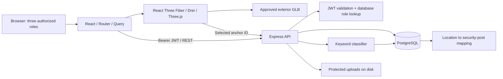

# System architecture

Audited 24 October 2026. Source of truth: `src/App.jsx`, `backend/server.js`, routes/controllers, `backend/config/dbOptions.js`, `backend/ml/nlpService.js` and `backend/services/threeDService.js`.

The React single-page application uses React Router for navigation and TanStack Query for API state. The query client is recreated for each signed-in identity and cleared on disposal to prevent report caches surviving account changes. Axios attaches the bearer token; an authentication failure returns the session to login. JWTs are held in localStorage, which makes XSS prevention important. Logout removes local identity and token; it does not revoke an already-issued JWT on the server.

Express validates HS256 tokens, expiry and the current database account/role on protected requests. Roles are Pentadbir Sistem (administrator), Ketua Pengawal (chief), and Pengawal Keselamatan (guard). Authorization is enforced at the API as well as in navigation. Administrator and chief share dashboards and 3D reads, but report approval belongs to the chief, official action writes to the administrator, and guard submissions/attendance to the owning guard. See [API contract](API_REFERENCE.md).

PostgreSQL holds operational records, audit entries, notifications and 3D mappings. Parameterized SQL and transactions protect report/review/action writes. Guard-level advisory locks serialize overlapping assignment checks; unique attendance and action indexes defend duplicate records. The 3D service uses repeatable-read snapshots and bounds detail lists. It counts distinct posts to avoid duplicated totals when multiple anchors refer to one post.

Report submission invokes the current keyword classifier, stores a new NLP row, checklist answers and attachment references, and notifies active chiefs for High/Critical results. The saved experimental Naive Bayes JSON is incompatible with the runtime weights contract; learned counts do not drive current classifications. Latest analysis uses timestamp and ID ordering. No analysis is represented as Unknown in corrected dashboard/3D reads.

Files live under `backend/uploads` (fixed path; no configurable upload-root variable exists). Downloads require a token and an exact database reference with guard ownership checks. File signatures, counts and sizes are checked. Uploads must be backed up together with PostgreSQL.

The 3D page is lazy-loaded. GLB geometry remains a conceptual exterior. Seven allowlisted anchors identify visualization regions; nullable foreign keys attach them to posts. API refresh polling updates stored operational information; no sensor, GPS, physical occupancy or forecasting integration exists.

Deployment reuses Nginx, an Express container and PostgreSQL. Only Nginx publishes a port in Compose. TLS termination, hosting approval, secrets, backup restoration and hardware validation are release tasks. Nginx gives API/uploads precedence over static-file routing, caches hashed assets and returns 404 for missing model files. Docker image execution has not been verified in this environment.

Exportable source: [system-architecture.mmd](diagrams/system-architecture.mmd).
