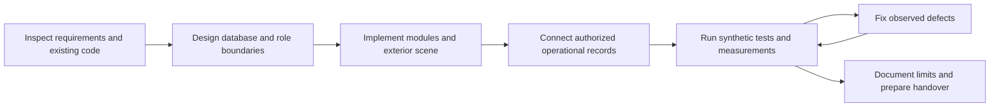
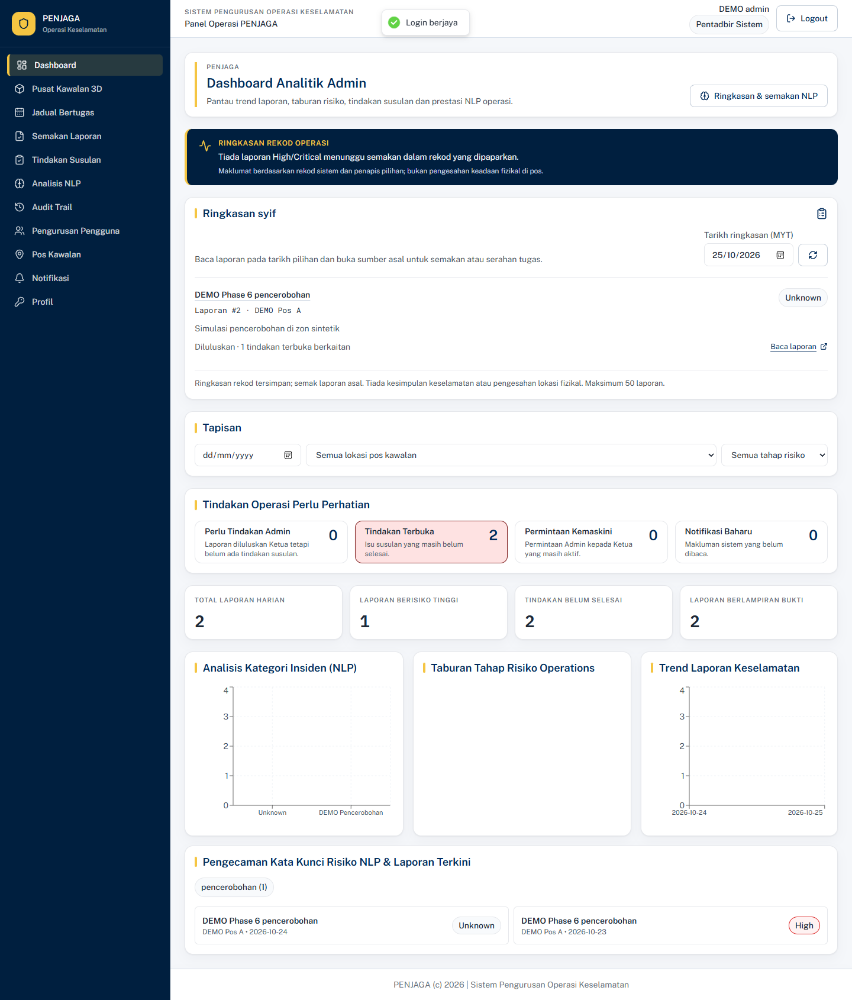
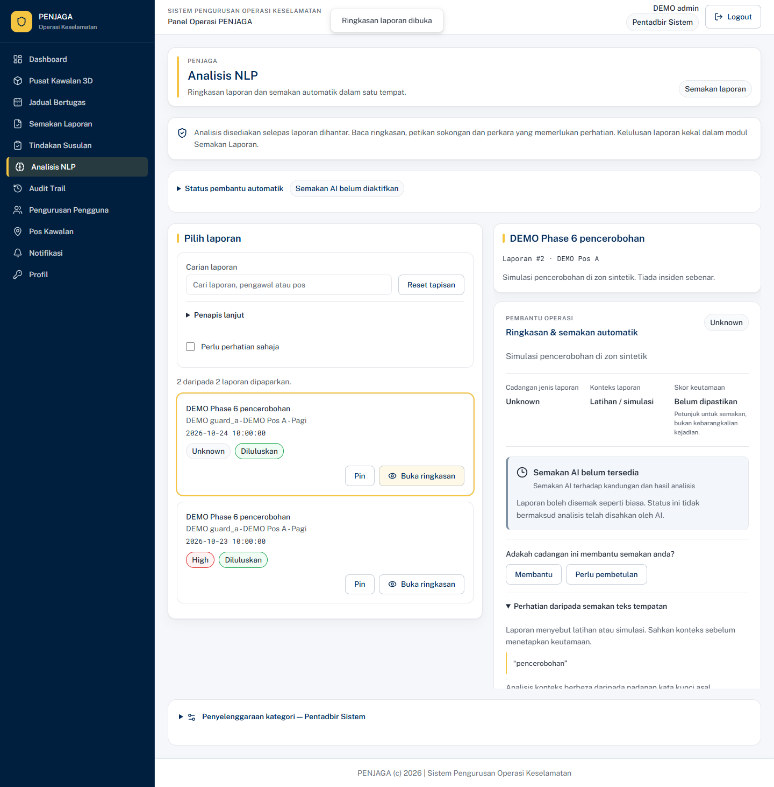

# PENJAGA — Final PSM report draft

**Working project title:** PENJAGA — Sistem Pengurusan Operasi Keselamatan Berasaskan Kepintaran Buatan.

**Status:** Adaptable academic draft, grounded in source inspection and local test evidence collected 24–25 October 2026. Student name/matric number, supervisor, programme, academic session, approved proposal/objectives, university template and rubric: **Pending verified input.** The conventional five-chapter organization below is not asserted to be mandatory UTHM formatting. Confirm the approved title, including whether “AI-assisted” appropriately describes the current keyword-based runtime.

## Abstract (draft)

PENJAGA integrates role-based security-operation workflows with an interactive exterior building visualization. A React frontend communicates with an Express API and PostgreSQL database to manage users, security posts, guard assignments, attendance, reports, review, follow-up actions and notifications. A Blender-derived GLB exterior is rendered with React Three Fiber. Seven visualization anchors can be linked by an administrator to stored security-post records. Operational summaries and incident history are retrieved through authenticated APIs with date and status filters. Source inspection established that current report categorization uses database-configured keyword rules: the experimental Naive Bayes training artifact is not compatible with the runtime inference contract. Local verification includes 69 existing automated checks and two Phase 6 workflow/screenshot tests, with detailed results in the testing appendix. Phase 5 software-renderer measurements show improved measured orbit performance after selected changes, but remain below a provisional 30 FPS target. The work demonstrates an integrated software prototype; architectural fidelity, representative-device performance, operational NLP accuracy and human usability benefit remain unverified. It is not a predictive system or fully synchronized physical digital twin.

# Chapter 1 — Introduction

## 1.1 Background

Security-operation records span staff assignments, attendance, observations, incident handling and supervisory decisions. A centralized application can make these related records accessible through consistent identities and database relationships. This is the design motivation for PENJAGA, not a claim that a particular organization has measured inefficiencies. The repository implements three roles: Pentadbir Sistem, Ketua Pengawal and Pengawal Keselamatan. Their permissions separate administration, supervisory review and personal reporting/attendance.

The 3D Command Centre adds a spatial entry point to records attached to security posts. Its building exterior depicts Bangunan SUK approximately, using photographic references. The geometry communicates recognizable exterior regions while operational records remain in PostgreSQL. A selected region retrieves a mapped post and its stored assignments, attendance, reports and actions. Geometry is not used to infer occupancy or real-time position.

## 1.2 Problem statement and evidence boundary

The demonstrated software problem is to connect otherwise distinct operational modules through shared role authorization, database relationships and understandable navigation. A further technical challenge is to associate a named visualization region with authorized operational records without fabricating building locations or presenting stored risk labels as physical danger predictions. Historical instructions requested these capabilities; code and tests establish what has actually been implemented.

No stakeholder interviews, baseline organizational audit, incident-response timing study or approved problem statement were available. Claims such as reduced paperwork, faster response, fewer staffing gaps or improved situational awareness must therefore remain hypotheses for evaluation, rather than established findings. The student must replace or align this section with the approved proposal and documented stakeholder evidence.

## 1.3 Provisional engineering objectives

O1: Integrate role-authorized scheduling, attendance, reporting, supervisory review and follow-up in a shared operational database.

O2: Provide an approximate exterior3D interface with selected-anchor retrieval of authorized post records, filters and incident history.

O3: Verify functional correctness and access boundaries, prepare reproducible deployment/demo materials, and evaluate performance using disclosed conditions.

These are reconstructed engineering objectives, **not verified approved PSM objectives**. The [traceability matrix](REQUIREMENTS_TRACEABILITY_MATRIX.md) must be reconciled with the signed proposal before submission.

## 1.4 Scope, significance and limitations

Scope includes a web application, three roles, PostgreSQL records, a conceptual exterior, seven allowlisted anchors and keyword-based report categorization. Guard scheduling is manual with conflict checks; it is not AI optimization. Attendance records check-in/out events without GPS or biometric validation. The contribution is an integrated prototype with explicit database-to-visualization mapping and testable access rules.

The prototype excludes internal architectural reconstruction, sensor synchronization, forecasting, physical guard tracking and measured organizational effectiveness. Known software limits include the password-change form without its backend endpoint, after-midnight attendance restrictions, incomplete legacy input validation, and unused trained-model counts. Production hosting, recovery and human evaluation remain pending. These affect release and academic claims but do not justify inventing successful outcomes.

## 1.5 Organization

Chapter2 reviews relevant concepts and remaining literature needs. Chapter3 describes the development evidence and system design. Chapter4 reports implementation and measured results. Chapter5 discusses achievement, limitations and future evaluation.

# Chapter 2 — Literature review framework

## 2.1 Security operations and digital reporting

The current artifact demonstrates report submission, classification storage, chief review, official follow-up and notification records. These define the comparison dimensions for further literature: permission separation, traceability of decisions, evidence handling and links between staff/post/incident information. A systematic review of security-operation and digital-reporting studies is **Pending literature verification**. No unverified commercial-product comparison or organizational efficiency result is included. Search and review peer-reviewed work with documented operational contexts; record sample, method, outcomes and applicability rather than treating a feature list as an evaluation.

## 2.2 Scheduling and attendance

Personnel scheduling is an established research area, as documented by Ernst and colleagues'2004 annotated bibliography [R1]. The verified institutional record establishes the publication's existence and scope; detailed algorithm comparisons require full-text review. PENJAGA implements manual assignment and interval-overlap rejection, not an optimization method from that literature. Evaluation should distinguish a valid assignment from adequate staffing and from verified physical attendance. No benchmark of optimality, fairness or travel time exists here.

## 2.3 Text classification and NLP evaluation

Manning, Raghavan and Schütze [R2] provide the academic background for text retrieval and classification. In this project, the training script produces an experimental multinomial Naive Bayes artifact from synthetic samples, while the runtime consumes a different weights format. Therefore a trained-model description must be confined to the training experiment. The operational classifier normalizes text, matches configured keyword substrings and adds priority scores. Future evaluation needs an independently labelled holdout set, a clearly stated category taxonomy, per-class precision/recall and analysis of negation or ambiguous wording. No operational accuracy is asserted.

## 2.4 Interactive3D, web delivery and digital twins

Khronos glTF2 [R4] defines the asset format underlying the GLB delivery pipeline. It is a technical standard rather than evidence of usability improvement. The implementation loads geometry/materials in a browser and resolves named anchors before requesting operational summaries. Whether spatial navigation helps users more than a table is a testable question, not a consequence of using3D.

Sharma and colleagues'2020 preprint [R3] discusses the varied features and evaluation difficulties of digital twins. Its distinction between conceptual ambitions and actual implementations is relevant here. PENJAGA has no physical sensing or bidirectional physical synchronization. Its APIs refresh database records, so the accurate project description is interactive 3D operational visualization. Building fidelity and data freshness should be assessed separately.

## 2.5 Usability and accessibility

WCAG 2.2 [R5] supplies an accessibility reference, not a certification of this application. Existing automated checks cover selected keyboard, reduced-motion, mobile-layout and WebGL-fallback behavior. They cannot establish full conformance or user preference. The repository contains task-based comparison and questionnaire instruments; collected participant data are absent. A consented evaluation should compare equivalent dashboard/table and 3D tasks, counterbalance order, retain completion/failure evidence and avoid treating repeated trials as independent participants. Any SUS or satisfaction score is pending valid responses and the chosen instrument's verified scoring guidance.

## 2.6 Synthesis and gap

The defensible engineering gap addressed by the prototype is integration of named spatial anchors with authorized operational records across several modules. Literature-backed claims of organizational or usability improvement require additional study. The review is a verified starting framework; it is not a completed systematic literature review. Student tasks include confirming full text for R1, expanding security/digital-reporting literature, and applying the university's citation format.

# Chapter 3 — Methodology

## 3.1 Evidence-supported development process

Repository changes and phase documents support an iterative implementation-and-verification process: inspect existing modules; prepare exterior assets; integrate rendering; add authenticated operational mapping; extend filters/history; test and improve security/performance; prepare final documentation. They do not prove that a formal Scrum, waterfall or design-science protocol was followed. No retrospective participant recruitment or stakeholder validation is claimed.

## 3.2 System and database design

React/Router/Query handle screens and data state. Express validates tokens and current account roles before controller SQL. PostgreSQL stores20 application tables. The actual ERD and complete column declarations are in [database design](../final/technical/DATABASE_DESIGN.md); the [architecture](../final/technical/SYSTEM_ARCHITECTURE.md) includes exportable Mermaid source. Foreign keys join users, posts, assignments, attendance, reports, NLP results, reviews, actions and progress. Nullable hotspot mappings keep unlinked geometry separate from missing operational records.

## 3.3 Implementation approach

Frontend development reused existing modules and role navigation. The3D page is lazy-loaded and separates loading/error handling, camera control, marker state, filters, history and information panels. Backend development uses parameterized SQL and transactions for important state changes. Advisory locks protect guard assignment conflict checks; unique indexes defend duplicate attendance and follow-up records. Uploads are signature/type/size checked and retrieved only through authenticated exact-reference checks.

NLP implementation currently uses active category keywords and priorities from PostgreSQL. Blender assets represent a conceptual exterior and retain editable source files. GLB anchors drive selection; only an administrator can link them to a security post. The operational service returns bounded snapshots and includes prior-day overnight assignments overlapping the selected Kuala Lumpur day. Recorded attendance is not interpreted as GPS location.

## 3.4 Verification and evaluation design

Automated checks use isolated synthetic databases, real JWT/role middleware, model inspection and browser interactions. Some3D browser tests intentionally mock APIs to isolate interface behavior; five Phase 5 workflows and the Phase 6 lifecycle use real local APIs. Software-renderer performance is disclosed separately from hardware performance. The final demonstration uses a separate named Phase 6 database with fictional users/posts/incidents; submitted report classifications are produced by the application. Existing operational databases were not reset or exported.

Human evaluation remains a planned study. Use the existing consent-compatible task plan and questionnaire only after supervisor approval, recruit eligible participants, minimize personal data and retain an auditable analysis. Do not report placeholder or synthetic arithmetic checks as participant findings.

# Chapter 4 — Implementation and results

## 4.1 Operational modules

Login produces a 12-hour JWT and an identity reflecting the database account. Protected API routes reject unauthorized roles independently of UI visibility. Guards submit reports/checklists/evidence and record their own attendance. Chiefs approve or reject submitted reports and add follow-up progress. Administrators manage users/posts/categories, official actions and mappings. The API contract documents53 endpoint definitions plus schedule/NLP router aliases, with actual response/error boundaries.

Final testing exposed and corrected PostgreSQL DATE conversion in schedule validation/coverage, and ambiguous parameter types in week/action status changes. Real API verification then confirmed valid assignment creation, overlap rejection, administrator confirmation/locking, chief locked-write denial, duplicate attendance rejection, report classification, review and action progress. A synthetic report containing pencerobohan produced stored High severity with score 75. This is an observed rule result, not classification accuracy.

## 4.2 3D implementation

The exterior GLB is2,537,652 bytes with 192 meshes,57,310 triangles and 13 materials. Seven anchors support selection and nullable post mapping. The browser supports camera orbit/zoom/pan, presets, focus animation, zone highlighting, marker modes, operational filters, selected information and paginated incident history. APIs distinguish unlinked, filtered, unavailable and Unknown-analysis states. Database totals de-duplicate posts shared by multiple anchors.

Actual screenshot evidence is indexed in [SCREENSHOT_INDEX](evidence/SCREENSHOT_INDEX.md). Representative figures below show only fictional demonstration information.

Figure4.1: Actual administrator dashboard using the isolated demo database.

Figure4.2: Approximate exterior with selected entrance and database-connected synthetic post panel. It does not establish a real security-post location.

Figure4.3: Application-produced analysis of a synthetic report; displayed confidence is keyword coverage.

## 4.3 Functional and authorization results

The rerun passed 33 backend tests,18 isolated3D browser tests, five genuine login/API browser workflows,10 model/logic checks and three evaluation-analyzer tests:69 existing checks in total. Two Phase 6 tests add a real synthetic lifecycle and actual screenshot capture. Counts describe automated test cases, not requirement coverage percentages or participant numbers. Detailed command results, known defects and sanitized API status evidence are in [FINAL_TESTING_REPORT](FINAL_TESTING_REPORT.md).

The final lint/build passed with one existing Fast Refresh warning and large frontend/3D chunks. Compose configuration validation passed. Docker image startup, public hosting and restore testing were not performed because the Docker daemon was unavailable and deployment was not authorized.

## 4.4 Phase 5 performance results

The before/after local benchmark used Edge headless with SwiftShader software WebGL, localhost without throttling, Node 24.15 and an i7-12650H with 16 logical CPUs. Desktop model-ready time changed from4321 ms to3471 ms; measured orbit FPS changed from9.95 to13.79. Emulated mobile model-ready time changed from2036 ms to1894 ms; orbit FPS changed from10.83 to19.49. These are observations from the recorded runs, not population estimates. Both measured orbit rates remain below the provisional 30 FPS target.

Draw calls per rendered frame changed384 to192 after static-shadow changes. Four route revisits changed from four GLB resource fetch/revalidation events to zero with session caching. Heap delta after four visits and GC changed approximately 3.373 MB to3.309 MB, which is insufficient evidence of leak freedom. Desktop selection was about 467 ms; mobile about 915 ms. Legacy-dashboard median API time increased from20.61 ms to56.16 ms following latest-analysis correctness changes. Consequently, a universal performance-improvement claim would be false. Consult original JSON and [PERFORMANCE_BENCHMARK](../psm-evaluation/PERFORMANCE_BENCHMARK.md).

## 4.5 Security and evaluation limits

Phase 5 dependency audit results fell from16 frontend advisories and 11 backend advisories (including two critical) to zero reported advisories at collection time. This is a dependency snapshot, not proof that the system has no vulnerabilities. Upload authorization, stale role/account rejection, malformed input and private development-file denial were tested in the documented scope. Human participant, physical-phone, production-security and independent NLP evaluations are **Pending verified results**. No SUS score, satisfaction percentage, response-time benefit or architectural-accuracy score is reported.

# Chapter 5 — Discussion and conclusion

## 5.1 Objective achievement

Provisional O1 is substantially demonstrated by integrated synthetic workflows, with password and overnight-attendance limitations preventing an unconditional operational-completeness claim. O2 is demonstrated for the approximate exterior and authorized synthetic mappings. It does not demonstrate real building-location accuracy or physical synchronization. O3 is demonstrated for local automated verification and preparation artifacts; production and human evaluation remain pending. Final achievement must be reassessed against the approved proposal.

## 5.2 Strengths and contribution

The prototype connects relational operational records to a spatial entry point while retaining API role enforcement. Explicit unlinked/Unknown/error states reduce misleading interpretation. Reproducible synthetic records and sanitized evidence allow academic demonstration without publishing personal operational records. The value established is an inspectable, testable integrated software artifact, not a proven organizational outcome.

## 5.3 Technical and study limitations

Password change lacks an API; after-midnight attendance is limited; some legacy validation and audit coverage are incomplete. The trained NLP artifact is not used for inference. Software-renderer orbit performance misses the provisional target, and large bundles remain. Exterior dimensions and real operational anchor mappings are unvalidated. There are no participants, representative device comparisons, production recovery drills or independent incident labels. These limitations constrain generalization and should be explained to examiners directly.

## 5.4 Future work

Prioritize the authentication/attendance gaps and validation consistency. Integrate one explicit NLP inference contract and independently evaluate labelled data before extending AI claims. Validate exterior accuracy with authorized references and add zones only with approved geometry. Profile representative hardware and optimize measured bottlenecks. Conduct consented comparative usability tasks and interpret effects with appropriate uncertainty. Hosting and maintenance require approved infrastructure, tested backups, monitoring and account lifecycle procedures.

## 5.5 Conclusion

PENJAGA provides an integrated security-operation prototype with a database-connected 3D exterior interface. The evidence supports local functional integration and clearly bounded performance observations. It does not yet establish improved human task performance, operational NLP accuracy or production readiness. The accompanying handover identifies the work necessary for academic submission and responsible further deployment.

# References (provisional author-date format)

R1. Ernst,A.T., Jiang,H., Krishnamoorthy,M., Owens,B., & Sier,D. (2004). An annotated bibliography of personnel scheduling and rostering. *Annals of Operations Research,127*(1–4),21–144. [Author-institution bibliographic record](https://research.monash.edu/en/publications/an-annotated-bibliography-of-personnel-scheduling-and-rostering/). Metadata verified; detailed full-text comparison pending.

R2. Manning,C.D., Raghavan,P., & Schütze,H. (2008). *Introduction to Information Retrieval*. Cambridge University Press. [Authors' Stanford companion site](https://nlp.stanford.edu/IR-book/). Verified publication and classification background; no numerical PENJAGA result derived from this book.

R3. Sharma,A., Kosasih,E., Zhang,J., Brintrup,A., & Calinescu,A. (2020). *Digital Twins: State of the Art Theory and Practice, Challenges, and Open Research Questions*. arXiv:2011.02833v3. [Original preprint](https://arxiv.org/abs/2011.02833). Cited as the verified2020 preprint, not an assumed later publication version.

R4. Khronos Group. *glTF 2.0 Specification*. [Official specification](https://registry.khronos.org/glTF/specs/2.0/glTF-2.0.pdf). Technical standard; accessed24October 2026.

R5. W3C. (2024,12December). *Web Content Accessibility Guidelines (WCAG)2.2*. [Official Recommendation](https://www.w3.org/TR/WCAG22/). Accessibility reference; no conformance claim.

# Appendices and submission controls

A. [Implementation audit](../final/PROJECT_IMPLEMENTATION_AUDIT.md) and [traceability](REQUIREMENTS_TRACEABILITY_MATRIX.md).

B. [Database design/ERD](../final/technical/DATABASE_DESIGN.md), [API contract](../final/technical/API_REFERENCE.md), and [system architecture](../final/technical/SYSTEM_ARCHITECTURE.md).

C. [Synthetic screenshot evidence](evidence/SCREENSHOT_INDEX.md) and [final test report](FINAL_TESTING_REPORT.md).

D. [User evaluation plan](../psm-evaluation/USER_ACCEPTANCE_TEST_PLAN.md), [questionnaire](../psm-evaluation/USABILITY_QUESTIONNAIRE.md), and [analysis limitations](../psm-evaluation/EVALUATION_ANALYSIS.md).

E. [Installation](../final/INSTALLATION_GUIDE.md), [deployment](../final/DEPLOYMENT_GUIDE.md), [user manual](../final/USER_MANUAL.md), [presentation script](PRESENTATION_SCRIPT.md) and [demo script](LIVE_DEMONSTRATION_SCRIPT.md).

Before submission: align the approved objectives/title/template; supply verified student/supervisor/session details; expand and review literature; obtain approvals and collect real evaluation data if required; replace pending results only with evidence; check citations/figure numbering and final format. Do not include tokens, passwords, personal data or restricted building plans.
